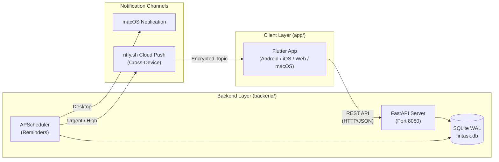

# Architecture Overview

Fintask is an intelligent, cross-platform financial task management system built with Flutter and FastAPI.

## Project Structure

```text
fintask/
├── app/                  # 💙 Multiplatform Flutter Client Application (Android, iOS, Web, macOS)
│   ├── android/          # Android native shell & manifest
│   ├── ios/              # iOS native Runner & entitlements
│   ├── macos/            # macOS desktop application shell
│   ├── web/              # Web application entry & manifest
│   ├── lib/              # Core Flutter / Dart source code
│   │   ├── models/       # Task, Stats, and domain models
│   │   ├── screens/      # Main application views
│   │   ├── services/     # REST API, audio, & notification services
│   │   ├── theme/        # Glassmorphic dark styling & typography
│   │   ├── utils/        # NLP natural language task parser
│   │   └── widgets/      # Modular UI components & bottom sheets
│   └── test/             # Flutter widget and unit tests
│
├── backend/              # ⚡ High-Performance FastAPI Python Backend
│   ├── scripts/          # Workspace calculation & data transformation jobs
│   ├── static/           # Compiled web assets and landing bundle
│   ├── downloads/        # Direct-distribution build binaries (APK)
│   ├── db.py             # SQLite WAL storage & task lifecycle models
│   ├── main.py           # REST endpoints, CORS, background lifecycles
│   ├── reminders.py      # Background APScheduler & ntfy.sh push dispatcher
│   ├── requirements.txt  # Python package dependencies
│   └── run.py            # Local backend server runner
│
├── test/                 # 🧪 Automated Test Suites
│   └── test_db.py        # Backend database & API unit tests
│
├── documentation/        # 📚 Architectural, API, and Deployment Guides
│   ├── ARCHITECTURE.md   # System layout & component relationships
│   ├── API.md            # REST API specifications and contracts
│   ├── DEPLOYMENT.md     # Railway, Docker, & Firebase deployment procedures
│   └── MOBILE.md         # Mobile build and notification setup
│
├── artifacts/            # 📦 Output Binaries & Distribution Assets
│   └── fintask.apk       # Compiled Android release APK package
│
├── deployment/           # 🚀 Container & Cloud Deployment Configurations
│   ├── Dockerfile        # Production container image definition
│   ├── railway.json      # Railway cloud configuration & health checks
│   ├── Procfile          # Process entrypoint
│   ├── firebase.json     # Firebase Hosting static web config
│   ├── .firebaserc       # Firebase active project specification
│   └── .dockerignore     # Build context filtering rules
│
├── scripts/              # 🛠️ Automation & Build Tooling
│   └── build_apk.sh      # Automated Flutter APK compilation & artifact syncer
│
└── archive/              # 🏛️ Historical Backups & Deprecated Code
    └── frontend_react_backup/
```

## System Workflow



